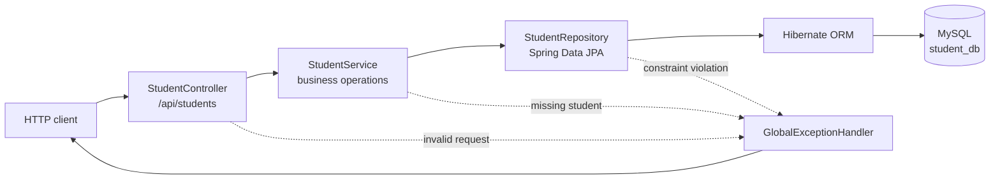
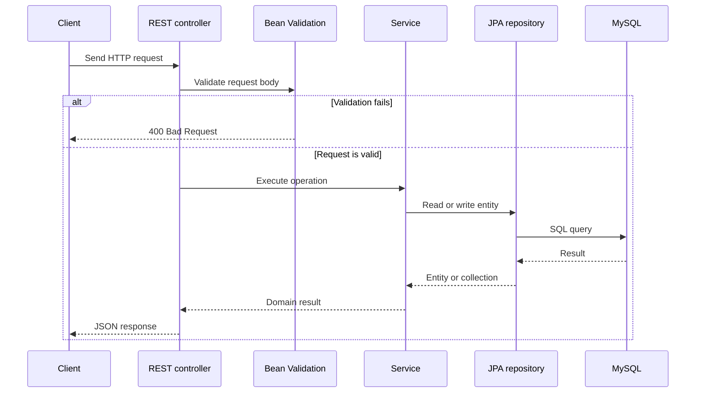
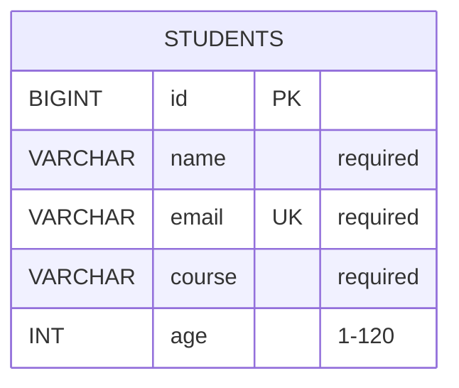
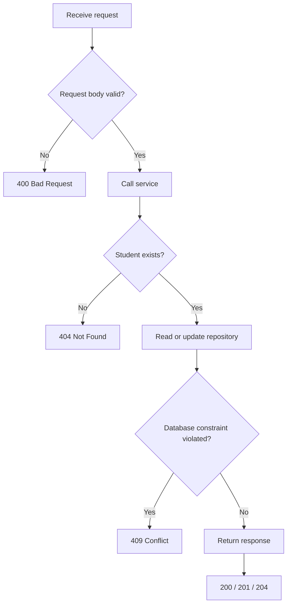

# Student Management API


A small, layered REST API for managing student records. The service is built with
Spring Boot, Spring Web, Spring Data JPA, Bean Validation, and MySQL.

> **Project status:** The API is suitable for local development and as a foundation
> for a production service. Before deploying it publicly, complete the hardening
> checklist in [Production considerations](#production-considerations).

## Contents

- [Capabilities](#capabilities)
- [Architecture](#architecture)
- [Technology stack](#technology-stack)
- [Prerequisites](#prerequisites)
- [Getting started](#getting-started)
- [Configuration](#configuration)
- [API reference](#api-reference)
- [Validation and errors](#validation-and-errors)
- [Data model](#data-model)
- [Project structure](#project-structure)
- [Request lifecycle](#request-lifecycle)
- [Screenshots](#screenshots)
- [Verification](#verification)
- [Production considerations](#production-considerations)
- [Troubleshooting](#troubleshooting)

## Capabilities

- Create, retrieve, update, and delete student records.
- Retrieve students by course using a case-insensitive filter.
- Validate names, email addresses, courses, and age values at the API boundary.
- Enforce unique email addresses at the database layer.
- Return consistent JSON error bodies for missing resources, invalid requests,
  duplicate emails, and unexpected failures.
- Automatically create/update the `students` table through Hibernate in the
  default local-development configuration.

## Architecture

The application follows a conventional layered architecture. HTTP concerns stay
in the controller, business rules are handled by the service, and persistence is
delegated to Spring Data JPA.



### Request flow



## Technology stack

| Area | Technology |
| --- | --- |
| Language | Java 25 |
| Framework | Spring Boot 3.3.5 |
| HTTP | Spring Web / REST |
| Persistence | Spring Data JPA + Hibernate |
| Database | MySQL |
| Validation | Jakarta Bean Validation |
| Build | Apache Maven |
| Testing support | Spring Boot Starter Test |

## Prerequisites

Install the following before running the service:

1. JDK 25.
2. Apache Maven 3.9 or later.
3. MySQL 8.0 or later.
4. A REST client such as `curl`, Postman, or Insomnia.

Confirm the tools are available:

```bash
java -version
mvn -version
mysql --version
```

## Getting started

### 1. Clone and enter the repository

```bash
git clone <repository-url>
cd student-management-system
```

### 2. Configure MySQL

Create the database, or allow the application to create it with the default
connection URL:

```sql
CREATE DATABASE student_db;
```

Create a dedicated application user for anything beyond local development:

```sql
CREATE USER 'student_api'@'localhost' IDENTIFIED BY '<strong-password>';
GRANT ALL PRIVILEGES ON student_db.* TO 'student_api'@'localhost';
FLUSH PRIVILEGES;
```

### 3. Set database credentials

Edit `src/main/resources/application.properties`, or provide equivalent
environment-specific configuration. Do not commit real credentials.

```properties
spring.datasource.url=jdbc:mysql://localhost:3306/student_db
spring.datasource.username=student_api
spring.datasource.password=<strong-password>
```

### 4. Start the application

```bash
mvn spring-boot:run
```

The API is available at:

```text
http://localhost:8080/api/students
```

To build and run the packaged application:

```bash
mvn clean package
java -jar target/student-management-1.0.0.jar
```

## Configuration

The current defaults are defined in
[`application.properties`](src/main/resources/application.properties):

| Property | Default | Purpose |
| --- | --- | --- |
| `server.port` | `8080` | HTTP port |
| `spring.datasource.url` | Local MySQL `student_db` URL | Database connection |
| `spring.jpa.hibernate.ddl-auto` | `update` | Synchronizes the schema during development |
| `spring.jpa.show-sql` | `true` | Logs generated SQL |
| `spring.jpa.properties.hibernate.format_sql` | `true` | Formats SQL logs |

For production, override credentials outside source control and use a migration
tool such as Flyway or Liquibase instead of relying on `ddl-auto=update`.

## API reference

Base URL: `http://localhost:8080/api/students`

| Method | Endpoint | Description | Success |
| --- | --- | --- | --- |
| `POST` | `/api/students` | Create a student | `201 Created` |
| `GET` | `/api/students` | List all students | `200 OK` |
| `GET` | `/api/students/{id}` | Get one student | `200 OK` |
| `PUT` | `/api/students/{id}` | Replace editable student fields | `200 OK` |
| `DELETE` | `/api/students/{id}` | Delete a student | `204 No Content` |
| `GET` | `/api/students/course/{course}` | Filter by course, ignoring case | `200 OK` |

### Student resource

```json
{
  "id": 1,
  "name": "Rahul Sharma",
  "email": "rahul@example.com",
  "course": "Computer Science",
  "age": 20
}
```

`id` is generated by the database and should be omitted when creating a student.

### Create a student

```bash
curl -X POST http://localhost:8080/api/students ^
  -H "Content-Type: application/json" ^
  -d "{\"name\":\"Rahul Sharma\",\"email\":\"rahul@example.com\",\"course\":\"Computer Science\",\"age\":20}"
```

Response: `201 Created`

### List students

```bash
curl http://localhost:8080/api/students
```

### Get a student

```bash
curl http://localhost:8080/api/students/1
```

### Update a student

```bash
curl -X PUT http://localhost:8080/api/students/1 ^
  -H "Content-Type: application/json" ^
  -d "{\"name\":\"Rahul Sharma\",\"email\":\"rahul@example.com\",\"course\":\"Data Science\",\"age\":21}"
```

### Filter by course

The course lookup is case-insensitive:

```bash
curl http://localhost:8080/api/students/course/computer%20science
```

### Delete a student

```bash
curl -i -X DELETE http://localhost:8080/api/students/1
```

## Validation and errors

### Input rules

| Field | Rules |
| --- | --- |
| `name` | Required and must not be blank |
| `email` | Required, must be a valid email address, and must be unique |
| `course` | Required and must not be blank |
| `age` | Required; integer from `1` through `120` |

### Error response shape

Errors use a consistent structure:

```json
{
  "timestamp": "2026-11-14T13:18:25.829",
  "status": 404,
  "error": "Not Found",
  "message": "Student not found with id: 999"
}
```

| Status | When it occurs |
| --- | --- |
| `400 Bad Request` | Request validation fails |
| `404 Not Found` | Requested student does not exist |
| `409 Conflict` | Email address violates the unique constraint |
| `500 Internal Server Error` | Unexpected server-side failure |

## Data model



## Project structure

```text
student-management-system/
├── src/
│   └── main/
│       ├── java/com/example/studentmanagement/
│       │   ├── StudentManagementApplication.java
│       │   ├── controller/StudentController.java
│       │   ├── entity/Student.java
│       │   ├── exception/
│       │   │   ├── GlobalExceptionHandler.java
│       │   │   └── ResourceNotFoundException.java
│       │   ├── repository/StudentRepository.java
│       │   └── service/StudentService.java
│       └── resources/application.properties
├── Database Screenshots/
├── Endpoints Screenshots/
├── pom.xml
└── README.md
```

## Request lifecycle



## Screenshots

Example API responses and database output are available in the repository:

| Scenario | Evidence |
| --- | --- |
| Create, update, delete, and retrieval responses | [`Endpoints Screenshots/`](Endpoints%20Screenshots/) |
| Database records | [`Database Screenshots/`](Database%20Screenshots/) |

## Verification

Compile and run the available test suite with:

```bash
mvn clean verify
```

For a quick smoke test after startup:

```bash
curl -i http://localhost:8080/api/students
```

Expected result: `HTTP/1.1 200` and a JSON array.

## Production considerations

Before exposing this service to users or the public internet:

- Move database credentials to a secret manager or deployment environment.
- Replace `ddl-auto=update` with versioned database migrations.
- Disable SQL logging and avoid returning raw exception messages.
- Add authentication, authorization, HTTPS, rate limiting, and audit logging.
- Add automated unit, integration, and API contract tests.
- Add health checks, metrics, structured logs, and centralized log retention.
- Configure backups, least-privilege database access, and connection pooling.
- Add pagination and filtering limits if the student table can grow significantly.
- Pin and regularly update dependencies through a vulnerability-management process.

## Troubleshooting

### Cannot connect to MySQL

Verify that MySQL is running, `student_db` exists, and the URL, username, and
password in `application.properties` are correct.

### Port 8080 is already in use

Stop the process using port 8080 or select another port:

```bash
mvn spring-boot:run -Dspring-boot.run.arguments="--server.port=8081"
```

### A duplicate email returns `409`

Email addresses are unique by design. Use a different email for a new student,
or update the existing student record.

## License

No license has been declared for this project. Add a license before distributing
the software outside the owning organization.
